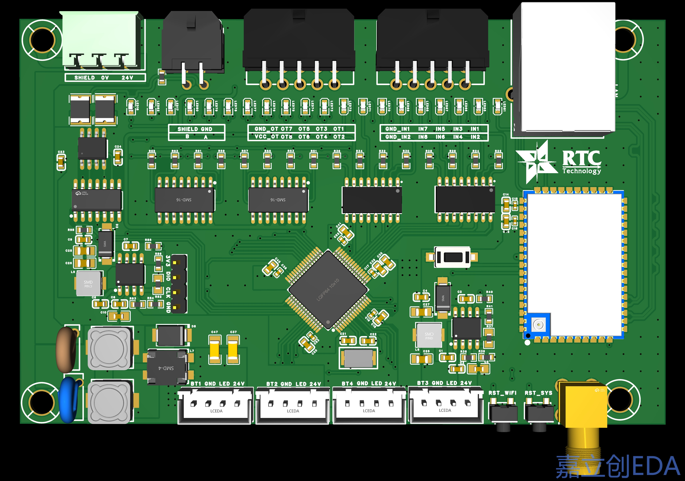
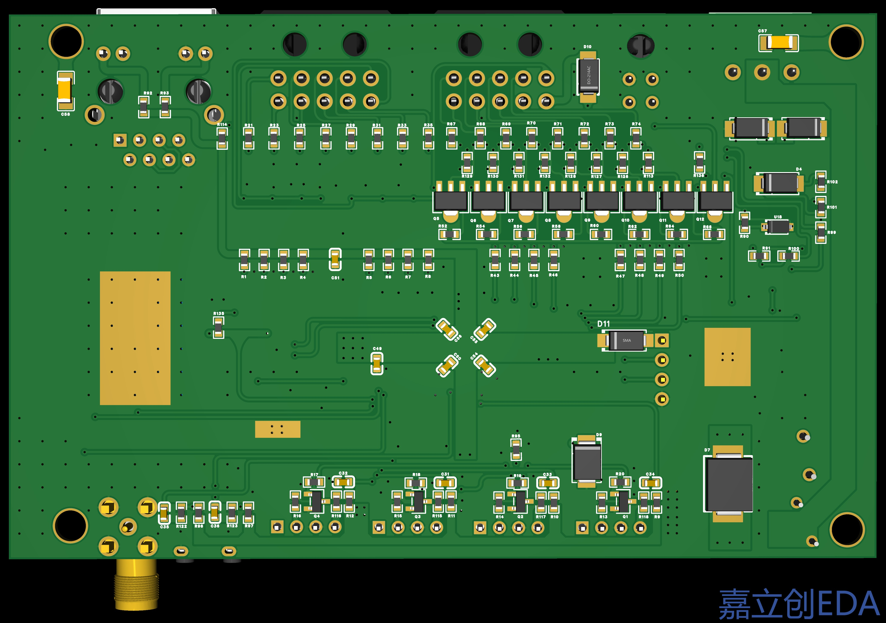

# AGV CALL SYSTEM RTOS

An industrial AGV/AMR calling system based on STM32F107RBT6 and FreeRTOS.

## 1. Project Overview

The AGV Call System is designed to communicate with AGV/AMR robots through an industrial network.

## 2. Hardware

- MCU: STM32F107RBT6
- 8 Input, 8 Output, 4 Button
- Wi-Fi Module: Hi-Link
- Operating System: FreeRTOS
- Communication: RS485, Ethernet/Wi-Fi

## 3. Firmware Features

- FreeRTOS multitasking
- Modbus RTU
- Modbus TCP
- HTTP, TCP/IP communication
- UART DMA and Interrupt
- GPIO input/output management
- Flash configuration storage

## 4. Hardware Design

### PCB Top Layer

### PCB Bottom Layer

## 5. Project Structure

- Core: Application source code
- Drivers: STM32 HAL and CMSIS
- Middlewares: FreeRTOS
